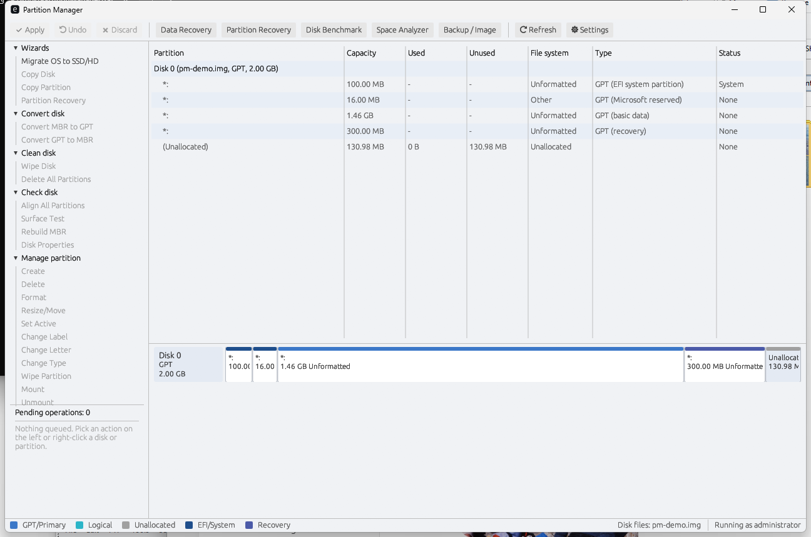

# Partition Manager

A Windows-first disk partition manager written in Rust. It shows every disk and partition,
creates, formats, resizes and moves partitions, clones and migrates disks, images them to
virtual-disk formats, rescues data from failing media, and recovers lost partitions and
deleted files. It ships as a wizard-driven desktop application (`partition-manager.exe`)
and a scriptable command line (`pm.exe`) that share the same engines.



Everything destructive goes through a pending-operations queue, a confirmation and a
write session that locks the disk first (see [Safety model](#safety-model)), and everything
can be practised risk-free on image files with `--disk-file`.

## Features

- **Enumerate, manage and mount.** Disks and partitions with capacity, usage, file system,
  type and status; create, delete, format, resize and move, set active, set type, change drive
  letter, wipe, convert MBR/GPT, align to 1 MiB, rebuild the MBR; mount and unmount at a drive
  letter or an empty folder.
- **Clone.** Copy a partition, volume, disk or image file. Smart mode copies only the blocks
  the file system marks used (NTFS, FAT, exFAT, ext); sector mode copies everything.
- **Migrate the OS.** Copy the Windows system partitions to another disk with fit or
  proportional sizing and an optional boot fix (`bcdboot` / `bootsect`).
- **Image and restore.** Save a disk or partition as raw, VHD (fixed or dynamic), VMDK
  (flat or sparse) or qcow2, convert between those formats, restore an image onto a disk.
  VHDX images can be opened read-only.
- **Rescue.** A ddrescue-style copier (copy, trim, scrape, retry) with a resumable mapfile in
  GNU ddrescue's format, for failing drives.
- **Recover.** Find lost partitions, list and restore deleted files from NTFS and FAT, carve
  files out of raw data by signature (images, documents, archives, audio, video, executables,
  databases), and save or reopen scan sessions.
- **Analyze.** Space analyzer (largest folders, files and extensions), surface test, disk
  benchmark, SMART health.

## Safety model

- **Pending queue and Apply.** The GUI never writes when you pick an action: it queues an
  operation and shows the resulting layout. Nothing happens until you click **Apply**, which
  lists every destructive step and asks for confirmation. **Undo** and **Discard** remove
  queued operations.
- **Dry run.** `Settings > Dry run` (or `partition-manager --dry-run`) makes Apply validate
  everything against the live disks and write nothing; the CLI has `--dry-run` as well.
- **CLI needs `--yes`.** `pm create`, `format`, `resize`, `apply`, ... print the operation and
  write nothing without `--yes`.
- **System-disk guard.** The running system disk is refused for destructive operations at
  three layers (planner, executor pre-flight, CLI argument checks). Resize, label, letter,
  mount and creating a partition in free space on it need an explicit `--allow-system-disk`.
  If the system disk cannot be determined, every disk is treated as protected.
- **Lock and dismount.** Writes happen inside a write session that locks and dismounts every
  volume on the disk (and takes a non-system disk offline). If a volume cannot be locked the
  operation stops before anything is written. There is no kernel driver.
- **Elevation.** The release `partition-manager.exe` carries a `requireAdministrator` manifest
  and asks for UAC on launch. Debug builds do not, so `cargo run` does not prompt.
- **Practice on image files.** `--disk-file PATH` presents a raw image file as a disk in
  both the GUI and the CLI. No administrator rights are needed and no physical disk is
  touched.

More detail, including where each check lives: [docs/ARCHITECTURE.md](docs/ARCHITECTURE.md).

## Build

You need a Rust toolchain (https://rustup.rs). All builds run from PowerShell:

```powershell
cargo build --release
```

The release binaries land in `target\release\`: `pm.exe` and `partition-manager.exe`.
`scripts\build-release.ps1` runs the build and copies both into `dist\`.

There are two ways to get a linker on Windows.

### Route A: GNU toolchain with a portable MinGW (what this repository is configured for)

This is the route for a machine without Visual Studio Build Tools. The repository pins
`stable-x86_64-pc-windows-gnu` in `rust-toolchain.toml`, and `.cargo/config.toml` points the
linker and `dlltool` at a portable WinLibs MinGW-w64:

```powershell
winget install --id BrechtSanders.WinLibs.POSIX.UCRT --scope user
```

`.cargo/config.toml` then selects (adjust the user name if yours differs):

```toml
[target.x86_64-pc-windows-gnu]
linker = "C:/Users/alain/AppData/Local/Microsoft/WinGet/Packages/BrechtSanders.WinLibs.POSIX.UCRT_Microsoft.Winget.Source_8wekyb3d8bbwe/mingw64/bin/gcc.exe"
rustflags = ["-C", "dlltool=C:/Users/alain/AppData/Local/Microsoft/WinGet/Packages/BrechtSanders.WinLibs.POSIX.UCRT_Microsoft.Winget.Source_8wekyb3d8bbwe/mingw64/bin/dlltool.exe"]
```

Because the linker path is explicit, the same `cargo build --release` also works from Git Bash.
The first build will install the pinned toolchain through rustup if it is missing.

### Route B: MSVC

1. Install **Visual Studio Build Tools** with the **Desktop development with C++** workload
   and a **Windows SDK**.
2. Delete `.cargo\config.toml` and `rust-toolchain.toml` (they only exist for Route A).
3. Build with the default `msvc` toolchain: `cargo build --release`.

The elevation manifest is embedded with `embed-resource` under MSVC, and with `windres` from
the MinGW directory under GNU; either way only in release builds (`PM_GUI_MANIFEST=1` forces
it into a debug build, `PM_GUI_MANIFEST=0` leaves it out of a release build).

## Run

### GUI

```powershell
.\dist\partition-manager.exe                       # elevated (UAC prompt), real disks
.\dist\partition-manager.exe --dry-run             # Apply only simulates
.\dist\partition-manager.exe --disk-file C:\img\practice.img
```

The release build always starts elevated. For development, `cargo run -p pm-gui` runs
unelevated: the real disk list is then empty with a banner, and `--disk-file` still works.
See [crates/pm-gui/README-gui.md](crates/pm-gui/README-gui.md) for the layout and the wizards.

### CLI

`pm.exe` needs an elevated prompt for physical disks and no elevation for image files. The
full, generated reference with every flag is in [docs/CLI.md](docs/CLI.md); the main
commands are:

```powershell
# Inspect
pm list [--json]                         # disks and partitions
pm table disk:1 [--json]                 # partition table of disk 1 (also: D:, an image file)
pm probe disk:1:2                        # which file system is on partition 2 of disk 1
pm ls disk:1:2 /Users                    # list a directory of a file system (read-only)
pm cat disk:1:2 /notes.txt               # write a file to stdout
pm extract disk:1:2 /Photos C:\restore   # copy a file or tree out
pm doctor                                # elevation, toolchain, disks seen

# Copy and images (these start copying immediately, after the safety refusals)
pm clone disk:1:2 disk:2:1 --smart       # partition to partition, used blocks only
pm clone C: E:\spare\c.img --sector      # c.img must already exist and be at least as large
pm image disk:1 D:\backup\disk1.vhd      # format from the extension, or --format vhd|vhd-fixed|vmdk|vmdk-flat|qcow2|raw
pm image disk:1:2 D:\backup\c.qcow2 --smart
pm restore D:\backup\disk1.vhd disk:2    # image onto a disk (--dst-offset 1M to place it)
pm convert disk1.vhd disk1.qcow2         # image to image
pm rescue disk:3 D:\rescue\copy.img D:\rescue\copy.map -r 2 -K 64K   # copy.img must exist and be big enough

# Operations (print and validate; write only with --yes; --dry-run validates only)
pm init-disk 2 --gpt --yes
pm create 2 --start 1M --len 100G --fs ntfs --label Data --letter E --yes
pm format 2 1 --fs fat32 --label USB --yes
pm resize 2 1 --start 1M --len 200G --yes
pm clone-disk 0 2 --sizing fit --boot-fix uefi --yes
pm migrate-os 0 2 --boot-fix uefi --yes
pm image-disk 1 D:\backup\disk1.vhd --yes       # the operation form of `image` (also image-partition, restore-image)
pm create 2 --start 1M --len 10G --emit-json > op.json   # build an operations file
pm apply ops.json --dry-run              # validate; add --yes to run
pm mount D: --letter X                   # or --folder C:\mnt\data
pm unmount X: --letter X

# Recover
pm recover partitions disk:3 --quick --session scan.json
pm recover partitions disk:3 --apply --yes --min-confidence 80
pm recover files disk:3:1 --dest C:\restore --min-integrity 50
pm recover carve disk:3 --types image,document --dest C:\carved --sector 512
pm recover open-session scan.json

# Analyze
pm analyze space C:\ --top 20
pm analyze surface disk:3 --block 1M
pm analyze bench D: --sizes 4K,64K --random
pm analyze smart 1
```

Exit codes: 0 success, 1 usage error, 2 platform or runtime error. Add `--disk-file PATH`
(repeatable; `disk:0` is the first file) to run any disk-taking command against image files.

## Try it on an image file

This walkthrough never touches a real disk and needs no elevation.

```powershell
# 1. Make a 2 GB raw image (it occupies 2 GB on disk until you delete it)
fsutil file createnew C:\img\practice.img 2147483648

# 2. Give it a GPT and two partitions (omit --yes first to see what would happen)
pm --disk-file C:\img\practice.img init-disk 0 --gpt --yes
pm --disk-file C:\img\practice.img create 0 --start 1M --len 1G --name Data --yes
pm --disk-file C:\img\practice.img create 0 --start 1025M --len 512M --type efi --yes

# 3. Look at the result
pm --disk-file C:\img\practice.img list
pm --disk-file C:\img\practice.img table disk:0

# 4. Open the GUI on it: queue, undo, dry-run and Apply all work on the file
partition-manager.exe --disk-file C:\img\practice.img

# 5. Save it as a VHD and as qcow2, then check them
pm image C:\img\practice.img C:\img\practice.vhd
pm convert C:\img\practice.vhd C:\img\practice.qcow2
```

On image files there is no volume layer, so creating a partition leaves it unformatted;
`format`, `mount`, `unmount` and drive letters report "not available on image files".
To practise a file-system workflow, image or clone a real partition into the file.

## Verifying images with external tools

The test suite checks every header field, but the real tools have the last word. Details and
the on-disk layouts are in [crates/pm-image/README-formats.md](crates/pm-image/README-formats.md).

```sh
qemu-img info    disk.qcow2        # format, virtual size, "corrupt: false"
qemu-img check   disk.qcow2        # expect: No errors were found on the image.
qemu-img check   disk.vmdk
qemu-img check   disk.vhd

# Byte-for-byte equality with the source after a convert/image:
qemu-img compare -f raw source.img -F qcow2 disk.qcow2
qemu-img compare -f raw source.img -F vmdk  disk.vmdk
qemu-img compare -f raw source.img -F vpc   disk.vhd
```

On Windows, a VHD can be attached with Hyper-V's tooling: Disk Management > Action >
Attach VHD, or

```powershell
Mount-DiskImage -ImagePath C:\img\practice.vhd
Dismount-DiskImage -ImagePath C:\img\practice.vhd
```

VMDK files attach to VMware or VirtualBox (`VBoxManage showmediuminfo disk.vmdk`).

## Known limitations

- **Creating file systems.** Partition Manager does not implement NTFS, ReFS or exFAT
  creation; those formats are made by Windows (`format`, via the platform layer). Only FAT32
  has a built-in formatter, used for images and tests. On image files nothing can be formatted.
- **Resizing.** Only NTFS can be shrunk and grown (through Windows); ReFS can only be grown.
  Other recognised file systems can be moved but not resized. A partition with no recognised
  file system changes in the partition table only.
- **Not supported.** Dynamic disks, BitLocker volumes, RAID/LVM, a bootable rescue-media
  builder, defragmentation.
- **MBR extended layouts** with less than 1 MiB between the EBRs (legacy cylinder-aligned
  layouts) are read-only: they are shown and can be cloned, but not edited.
- **VHDX is read-only.** It can be opened, listed, imaged from and converted from, but not
  created or written; writing VHDX is a TODO. Differencing VHDX/VHD, and VHDX logs from an
  unclean shutdown (not replayed), are not supported.
- **Set label** is queued and validated but not yet wired to a platform API, so applying it
  fails with "set label requires platform support (planned)"; give the label when you
  create or format the partition.
- **ext2/3/4** are read-only (browse, extract, smart clone). **APFS, btrfs, XFS, HFS+, LUKS**
  and others are detected and cloned sector by sector, nothing more.
- **No VSS snapshot** is taken for live system volumes. Imaging or cloning a mounted, in-use
  volume can capture an inconsistent file system; image the system disk from another OS or a
  disk that is not in use.
- **Hard links, junctions and storage aliases** are not detected by the source/destination
  overlap checks of the direct-copy commands.
- **Linux/macOS.** The `pm-platform` crate has a `NullPlatform` stub (every OS call fails
  with `Unsupported`) so the workspace's engines compile and test on other systems, but there
  is no real Linux implementation yet: the Linux build is a stub. Benchmarking is Windows
  only.

## Project layout

| Crate | Purpose |
|---|---|
| `pm-core` | `BlockDevice` trait, file/memory/slice devices, errors, progress and cancellation, size units, disk/partition domain model |
| `pm-parttable` | MBR and GPT read/plan/write, alignment, MBR/GPT conversion, lost-table search |
| `pm-platform` | `Platform` trait; Windows implementation (`windows-sys`), `NullPlatform` stub, `FilePlatform` (`--disk-file`), `MockPlatform` (tests) |
| `pm-fs` | File-system detection; read-only NTFS, FAT, exFAT and ext parsers; used-block bitmaps; FAT32 formatter |
| `pm-image` | Raw, VHD, VMDK, qcow2 images (and read-only VHDX) as block devices; format conversion; ddrescue-style rescue engine and mapfile |
| `pm-recover` | Lost-partition finder, deleted-file recovery, signature carver, scan sessions |
| `pm-analyze` | Space analyzer, surface test, benchmark, SMART |
| `pm-ops` | Operation model, pending queue, planner/simulator, executor, clone/migrate sizing |
| `pm-cli` | The `pm` command line |
| `pm-gui` | The `partition-manager` desktop application (eframe/egui) |

Other documents: [docs/CLI.md](docs/CLI.md) (command reference),
[docs/ARCHITECTURE.md](docs/ARCHITECTURE.md) (dependency graph, clone data flow, safety
checks), [docs/superpowers/specs/2026-10-19-partition-manager-design.md](docs/superpowers/specs/2026-10-19-partition-manager-design.md)
(design spec).

## Testing

```powershell
cargo test --workspace
```

The tests run on synthetic images and the mock platform and need no administrator rights.
Tests that touch real Windows volumes or disks are marked `#[ignore]`; run them from an
**elevated** prompt with `cargo test --workspace -- --ignored`.

## License

MIT (see `license = "MIT"` in `Cargo.toml`). There is no separate `LICENSE` file yet.

## Credits

The UI is inspired by MiniTool Partition Wizard, and the rescue engine follows the algorithm of
GNU ddrescue (and writes the same mapfile format). No code from either project is used.
